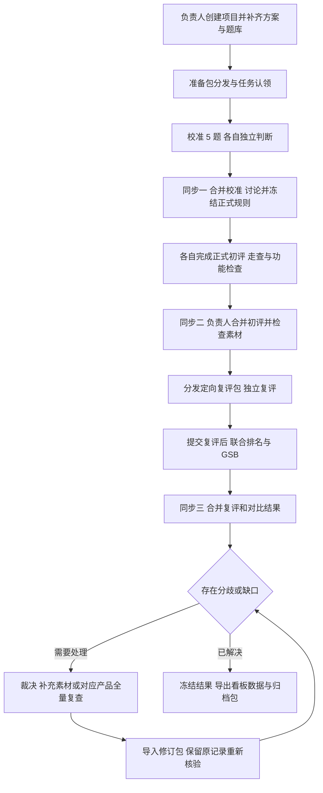

# 信息架构与核心流程

## 设计目标

页面围绕本次评测的实际推进组织。评测员日常从“我的任务”继续工作；负责人从“项目总览”检查阶段与缺口，再通过“数据同步”形成下一阶段的任务包。

网站的公开访问不代表项目数据公开或实时共享。V1 的三人协作依赖本地记录、负责人合并和明确的阶段数据包。项目进度显示“本机已完成”和“负责人合并版进度”两种口径，并标明版本及时间。

## 信息架构

```text
工作台入口
├─ 演示项目：独立模拟数据，可重置
├─ 新建项目：创建本地项目与负责人身份
└─ 导入数据包：加入项目 / 恢复备份 / 执行阶段任务

项目工作区
├─ 项目总览
│  ├─ 当前阶段与下一步
│  ├─ 本机进度 / 最近合并版进度
│  └─ 待补输入、存疑与缺图
├─ 方案与题库
│  ├─ 项目信息、产品与成员
│  ├─ 维度、标签、计分规则与规则版本
│  └─ 题库、参考图与分布检查
├─ 我的任务
│  ├─ 校准任务 → 逐题评审
│  ├─ 正式初评 → 逐题评审
│  ├─ 编辑走查与功能检查
│  └─ 交叉复评 / 重新核查 → 对应评审界面
├─ 质量控制
│  ├─ 校准差异与参考案例
│  ├─ 存疑讨论与裁决
│  └─ 复评一致率、分歧与全量复查
├─ 对比评审
│  ├─ 抽选 12 题的联合排名
│  └─ 自家与竞品的直接 GSB
├─ 结果看板
│  ├─ 维度分、总分、可用率与问题分布
│  ├─ 分场景 / 品类 / 难度表现
│  └─ 联合排名净胜率 / 直接 GSB 净胜率及样本明细
└─ 数据同步
   ├─ 导出任务包 / 提交包 / 完整备份
   ├─ 导入校验、合并预览与冲突处理
   └─ 导入记录、版本与备份状态
```

一级导航稳定，校准、初评、走查、复评作为任务类型进入相应界面。进入单题后可在侧栏连续切题，提交后回到任务列表或下一题。页面视觉与具体交互在第 4 步继续设计。

## 核心流程



准备包是开始工作的基础分发，不计入三次阶段同步。三次同步是正常主路径；发生规则修订、素材缺失或全量复查时，允许追加修订包，不以“必须只有三次”为约束。

## 阶段定义与进入条件

| 阶段 | 主要执行者 | 工作与输出 | 下一步的条件 |
| --- | --- | --- | --- |
| 准备 | 负责人 | 方案、产品、成员、50 题与参考图；初始分工与准备包 | 必填信息、题量、ID、权重与标签引用通过校验，相关人员已拿到准备包 |
| 校准 | 三人独立评审，随后共同讨论 | 覆盖场景的 5 题、共用生成素材、独立判断与校准案例 | 必要判断齐备，分歧有讨论结论，正式规则冻结 |
| 正式评测 | 各产品负责人 | 各竞品 50 题初评、3 个编辑走查、整体体验分和功能检查 | 所有正式任务有提交状态；必需记录与原图完整，失败任务有明确状态 |
| 复评与对比 | 复评员、联合评审组 | 每产品随机 10 题独立复评；12 题联合排名；具有有效素材的直接 GSB | 独立复评提交完成后再参与会揭示产品差异的联合讨论；比较结果有明确样本集合 |
| 处理与汇总 | 负责人组织，三人参与 | 不一致判断、裁决、必要的全量复查、统计与归档 | 分歧与缺口已处理，规则口径明确；正式结果仅使用有效真实数据 |

页面在任意阶段都可查看已保存的本地草稿。未达到条件时仍允许保存和备份，但进入下一正式阶段或输出最终报告时，显示具体待办；允许导出明确标记为“未完成”的进度数据。

## 校准素材与正式任务的关系

按当前三个真实竞品计算，5 道校准题对应 15 组产品输出，三人分别独立判断，共 45 份校准判断。数量由活跃真实产品和评测员集合推导，不写死在流程中。

校准的生成素材复用于对应正式题目，不为校准后重新生成。正式规则冻结后，由各产品负责人基于这些原始素材确认自己的正式初评记录。校准判断单独保存，既不算成多份正式初评，也不作为额外题目加入 50 题分母。

首次生成校准素材时就记录耗时、失败状态、总张数、所有原图和费用归属；正式阶段引用同一生成记录。无法取得的字段标为缺失，不事后估填，也不把同一批生成成本重复计算。

讨论若修改标签定义，生成新的规则版本，并记录从校准版本到正式版本的变化。已经进行的校准判断保留其原规则版本，不能静默覆盖后重新比较。

## 三次同步的用户动作

| 节点 | 评测员操作 | 负责人操作 | 再分发内容 |
| --- | --- | --- | --- |
| 同步一：校准后 | 导出独立校准提交包 | 合并三人的判断，组织差异讨论，发布正式规则快照 | 校准结论、标签示例、正式规则和任务版本 |
| 同步二：初评后 | 导出初评、走查、功能检查与全部相关原图 | 校验与合并；按固定抽样结果建立交叉复评任务 | 每人的定向复评包；联合比较所需的题目与素材包，不含原评分 |
| 同步三：复评与对比后 | 导出独立复评、联合排名或 GSB 结果 | 合并、计算分歧与一致率，组织裁决；需要时追加全量复查任务 | 修订任务或最终结果包 |

同步二后的复评任务安排为 P1 的负责人复评 P2，P2 的负责人复评 P3，P3 的负责人复评 P1。每个产品随机抽取 10 题；保存抽样算法版本、随机种子与最终题号，避免重新导入后样本改变。具体产品名待补充。

## 评审记录与可见范围

每次初评、复评和裁决是独立记录。只有裁决或明确采纳动作才改变正式结果所引用的判断；原始判断始终保留。质量统计引用最初独立提交的初评和复评，不能在讨论后将两者改成相同标签，再报告为高一致率。

负责人拿到完整初评主包，但复评员只拿到为其生成的定向复评包。复评包包含任务要求、验收点、参考图、原始输出及最佳图标记，排除原标签、分数、可用张数、风险标记、排名，以及可能泄露原判断的自由文本备注。

负责人兼任复评员时，完整主包先在汇总空间暂存，导入预览只展示数量和完整性，不自动展开评分。系统可从暂存数据生成复评包；负责人在独立浏览器配置与复评空间提交自己的判断后，再显式揭示评分差异。该安排保证正常操作可执行，但无法阻止其主动读取本地包或旧数据。

本地模式提供单独的评测空间，减少切换身份后意外揭示信息。它不认证真实身份，也无法撤销用户先前已经获取的数据，因此不作为对抗性安全盲评系统。详见[评审可见范围](03-review-visibility.md)。

## 两种对比方法的关系

| 方法 | 输入 | 输出 | 统计边界 |
| --- | --- | --- | --- |
| 联合排名 | 抽选 12 题，各真实产品的最佳图；三人共同讨论 | 每题的共识排名，可并列；由排名推导两两胜、平、负 | 使用这 12 题中的有效共同样本，不与直接 GSB 混合 |
| 直接 GSB | 同一题中自家与某竞品的有效输出 | G 自家更好、S 持平、B 自家更差，以及理由 | 按产品对、样本集合和真实/含模拟来源分别统计；未比较不计为 S |

直接 GSB 净胜率为 `(G - B) / (G + S + B)`，分母为有效已提交比较。没有有效比较时显示“暂无数据”，不显示 0%。联合排名推导的净胜率也单独显示有效样本量。

若同一参与者同时做直接 GSB 和联合排名，重叠题先提交直接 GSB，再参加联合讨论。若该题已经讨论过，则标注判断受先前讨论影响；不能只靠隐藏页面上的名次，声称参与者尚未见过结论。

本项目保留模拟自家对三个竞品的逐题比较，共 150 个 GSB 任务。模拟自家可与同题的实际竞品素材组成“含模拟数据”的比较集合；任务和看板明确标记来源，并与三个真实竞品的联合排名结果分开展示。模拟自家素材尚未提供的任务显示“待补素材”，不会自动补成平局或凭空生成已完成记录。

三个真实竞品的数据就绪时可先导出竞品报告；若项目任务计划仍包含上述 150 个 GSB，则整体项目仍显示有待办，直到比较完成或负责人明确修订范围。实际自家素材日后加入时，创建新的真实比较集合，不把旧模拟判断自动转成真实判断。

## 中断、修订与结果冻结

- 评测中断：自动保存草稿；提交需要确认必填字段与图片已写入；异常写入明确提示未保存成功。
- 导入失败：展示原因与补救动作，保留本机现状；不会出现记录已写入而图片遗漏的半完成导入。
- 同一记录冲突：导入前展示两个分支及其来源，由负责人明确处理；原始分支保留。
- 已提交内容修改：形成新修订，说明原因。若影响复评或对比样本，相关任务标记为需要重新确认。
- 正式规则改变：从冻结快照创建新修订并说明影响范围，重新确认受影响任务；旧报告保持可追溯。
- 结果冻结：保存所用规则、数据修订集合、比较集合和生成时间；后续改动形成新结果版本。

## 第 4 步设计输入

流程确认后，关键页面依次设计：项目总览、方案与题库、逐题评测、数据同步、质量控制、对比评审、结果看板。真实评测优先，因此数据同步与质量控制同样是首版关键页面。

本阶段尚未形成界面原型、应用源码或部署结果。实际产品信息、完整题库及评分草稿中的待定口径，在正式发布任务前补齐。
